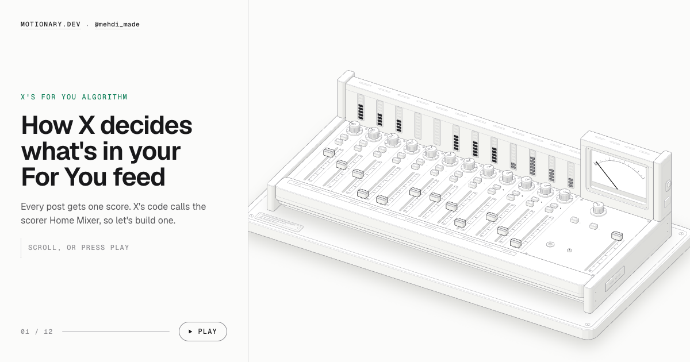

# How X ranks your For You feed

 

A scroll story that explains how X's For You algorithm scores a post. A mixing desk stands in for X's scorer (the service in X's code is called Home Mixer): each channel is an action you might take, its fader is the predicted chance, its knob is X's weight, and the meter adds them up.

**Live:** https://mahdidavoodi7.github.io/how-x-ranks-your-feed/

Press **Play** (or `P`) to have it scroll itself, which is handy for screen recording. Arrow keys and Space step through it.

Weights are the defaults in [xai-org/x-algorithm](https://github.com/xai-org/x-algorithm) (`home-mixer/params/param.rs`, synced 8 October 2026). The chances in the example posts are illustrative.

---

Made by [motionary.dev](https://motionary.dev/) · Follow [@mehdi_made on X](https://x.com/mehdi_made) for more explainers like this.
